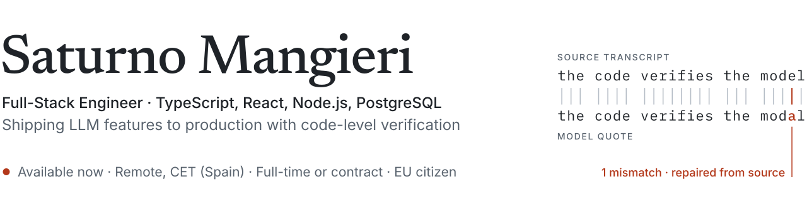

<picture>
  <source media="(prefers-color-scheme: dark)" srcset="assets/banner-dark.svg">
  <source media="(prefers-color-scheme: light)" srcset="assets/banner-light.svg">
  
</picture>

### Hi, I'm Saturno.

Full-stack engineer with 6+ years building web and mobile products in TypeScript, React and Node.js, always on fully remote teams. I put LLMs into production with guardrails: model output is verified by code, every paid call is accounted for, and a human has the final say.

**Available now** · Remote, CET (Spain) · Full-time or contract · EU citizen

---

## Featured: AI call analysis · Auto Mastery (2026)

Technical owner of the AI call-analysis features in a lead-auditing platform for a US marketing agency that serves auto repair shops. Two-engineer team, and I was the largest contributor. I took the MVP from design to validated delivery in two months.

The job: turn a shop's monthly paid calls into coaching reports a client can trust, with no invented quotes and no runaway model spend.

- **Model-free quote verification.** Every quoted phrase is checked character by character against the transcript, then repaired from the source or dropped. No fabricated quote reaches a client report.
- **LLM spend protection.** Each paid model response is stored before any rule runs. Failed runs recover, and reports rebuild deterministically without new model calls.
- **Batch runs of up to 300 calls** (batches of 35, 8 in parallel) with SSE streaming and live progress.
- **Human in the loop.** A moderator decides what enters each report, with versioned decisions, vetoes, history and a "delivered" lock.

Also: deterministic call classification (voicemail, booked appointments, store hours across time zones and DST), a hash-locked prompt, multi-tenant auth, and ~31k lines of server code covered by 65 test files.

`TypeScript` `Node.js` `Fastify` `React` `PostgreSQL` `Prisma` `Anthropic SDK (Claude)` `SSE` `Vitest`

▶ Walkthroughs: per request only.

The code is private. A live demo is available on request.

## Open source

| Project | What it is | Stack |
| --- | --- | --- |
| [rebaseline](https://github.com/theghost1980/rebaseline) · [npm](https://www.npmjs.com/package/rebaseline) | CLI to review failed Playwright screenshots in the browser and accept them as new baselines, locally or from GitHub Actions runs. No Docker. | TypeScript, Node.js, Playwright |
| [aegispad-nextjs-ai](https://github.com/theghost1980/aegispad-nextjs-ai) · [live](https://aegis-pad.netlify.app) | AI-assisted Markdown editor: revision, translation and dictation with the Gemini API. | Next.js, TypeScript, Gemini |
| [hivelens](https://github.com/theghost1980/hivelens) | Image indexing and search for the HIVE blockchain: 9,000+ images a day with searchable metadata. | TypeScript, Node.js |
| [hive-liquidity-pools-data-index](https://github.com/theghost1980/hive-liquidity-pools-data-index) | Public data index for HIVE liquidity pools: documented API, request validation, rate limiting and financial calculations. | TypeScript, Node.js |
| [keychain-helper](https://github.com/theghost1980/keychain-helper) | Library that simplifies frontend integrations with the Hive Keychain wallet. | TypeScript |
| [dashboard-saas](https://github.com/theghost1980/dashboard-saas) | SaaS dashboard architecture demo: component design, state isolation, performance and testing strategy. | React, TypeScript |

## Before that: Hive Keychain (2022–2024)

Frontend and full-stack product engineer on a crypto wallet (Chrome extension and React Native app) used by 10,000+ people, where a bug can move someone's money.

- Built a swap widget that generated $10,000+ in direct revenue in its first 5 months.
- Set up the project's first CI and testing environment (Jest, React Testing Library, TypeScript).
- Led a mobile UI refactor that cut up to 2 seconds from critical user flows.

<!-- TODO: add links to the swap widget and the onboarding site, e.g. [swap widget](URL) · [onboarding site](URL) -->

Code: [github.com/hive-keychain](https://github.com/hive-keychain)

## How I work with AI

I use AI coding assistants every day, under strict guardrails, and human review is the final authority on every commit. In products, I treat the model as an expensive, fallible component: plain code checks what it says, and deterministic rules take over wherever a model is the wrong tool.

## Stack

**Frontend:** React · TypeScript · Next.js · React Native · Vite · TanStack Query · Zustand · Tailwind

**Backend and data:** Node.js · Fastify · REST · PostgreSQL · Prisma · Supabase · Zod · SSE

**AI and LLMs:** Anthropic SDK (Claude) · prompt design · output verification · human-in-the-loop review · cost control

**Testing and delivery:** Vitest · Jest · React Testing Library · Playwright · CI/CD · Vercel · pnpm monorepos

## Contact

[saturnob612@gmail.com](mailto:saturnob612@gmail.com) · [LinkedIn](https://www.linkedin.com/in/saturno-mangieri) · [Portfolio](https://saturnodev.netlify.app)
<!-- TODO: add your Cal.com link: · [Book a 15-min call](https://cal.com/...) -->
